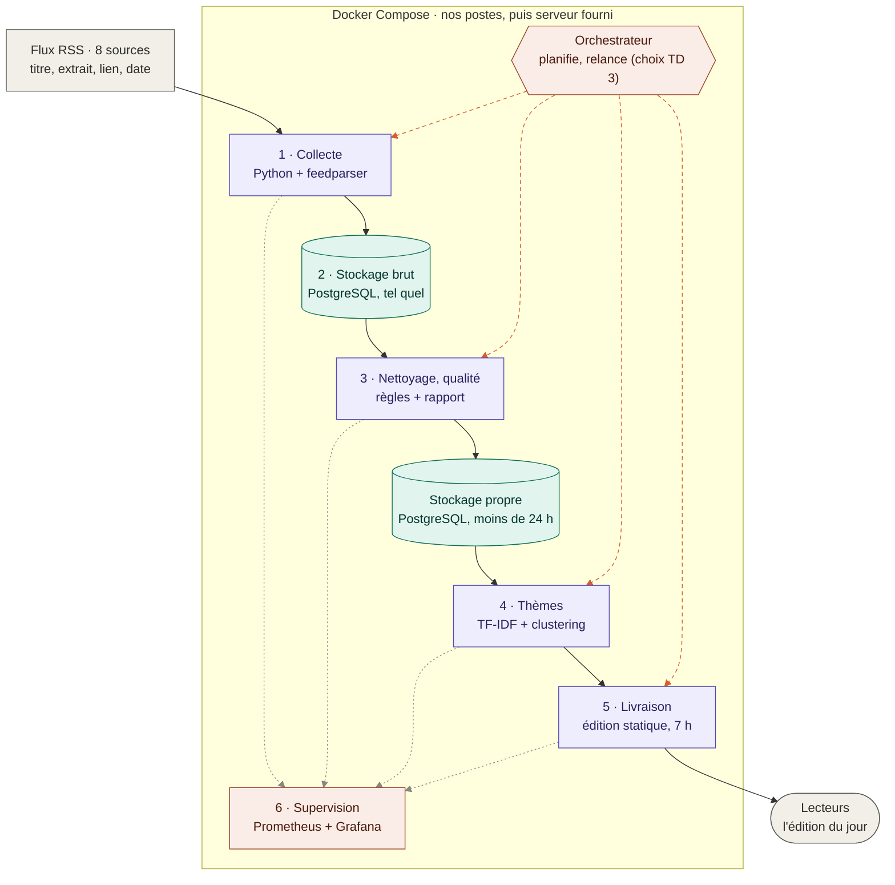

## Architecture

**Légende** : violet = traitement · vert = stockage · orange = exploitation ·
pointillés orange = l'orchestrateur déclenche · pointillés gris = métriques et journaux vers la supervision.